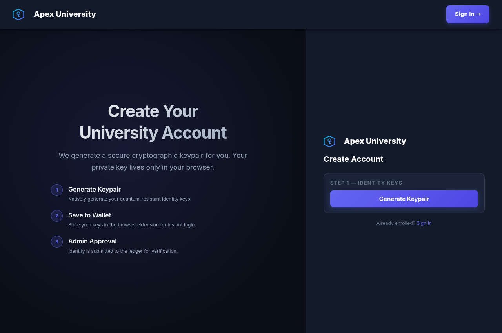
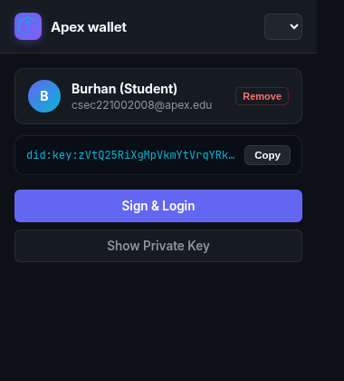
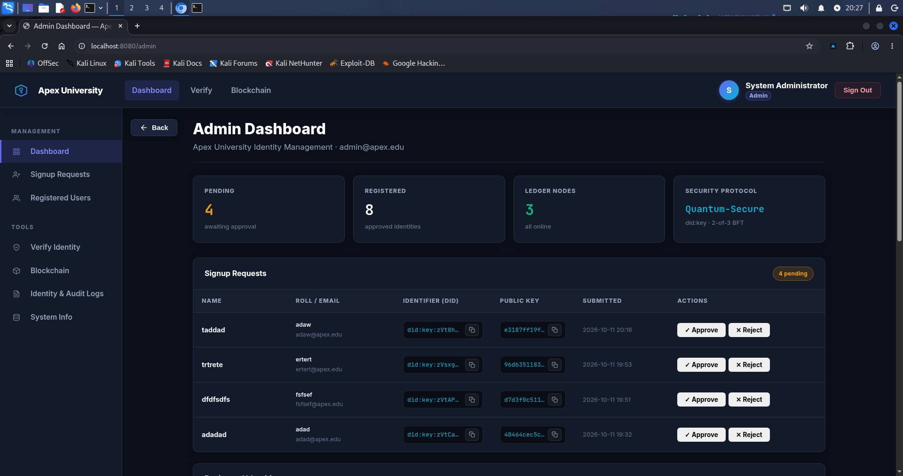
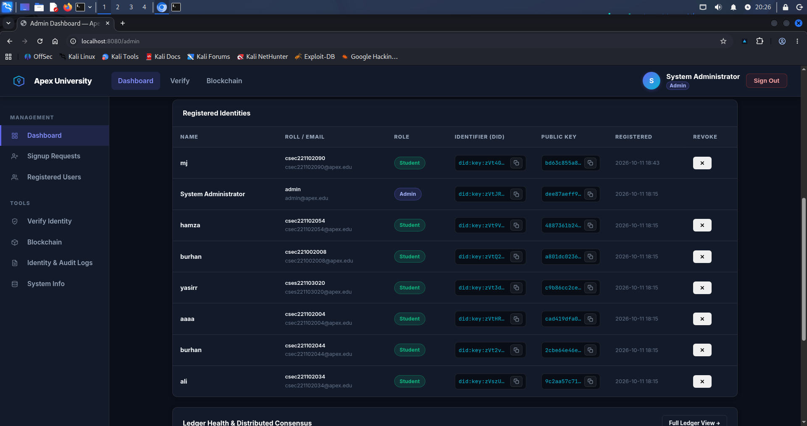
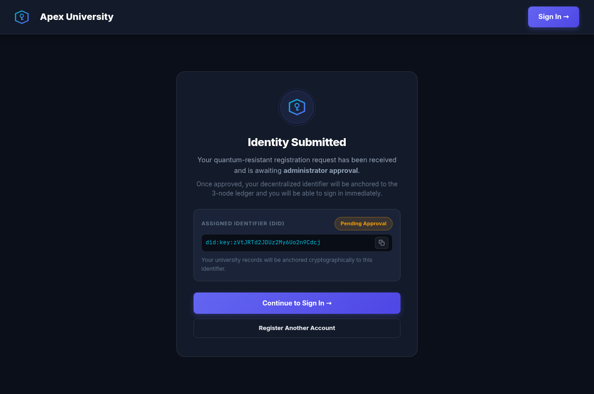
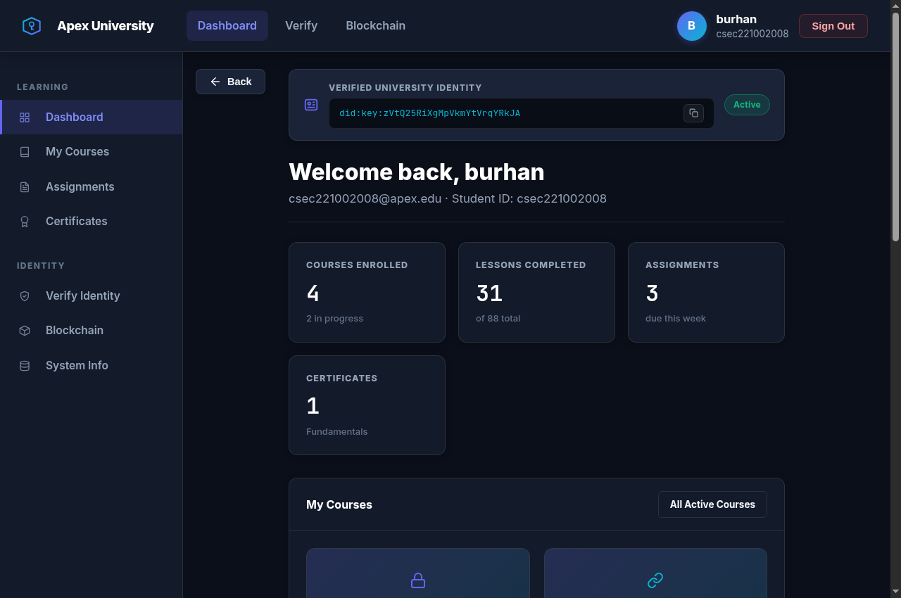

# Apex-PQ

# 🛡️ Apex-PQ: Post-Quantum Decentralized Identity & Ledger Ecosystem

[-4c1.svg)](#cryptographic-architecture)
[](#ledger-consensus)
[](#quickstart-with-docker-linux-macos)
[](#installing-the-apex-wallet-browser-extension)
[](LICENSE)

**Apex-PQ** is a production-ready, post-quantum secure decentralized identity (DID) management platform and distributed ledger architecture built for universities and enterprise institutions. 

Powered by NIST FIPS 204 **ML-DSA-44** (Crystals-Dilithium2) lattice-based digital signatures and an immutable **3-node Byzantine Fault Tolerant (BFT)** blockchain ledger, Apex-PQ eliminates vulnerable passwords, central database points of failure, and classical cryptographic risks posed by quantum computers.

---

## 📸 Visual Tour

### 1. University Identity Portal
The gateway to quantum-secure authentication. Users sign in using their assigned University Roll Number or DID through a zero-knowledge challenge-response cryptographic handshake.


---

### 2. Quantum Keypair Generation & Account Registration
Students generate ML-DSA-44 post-quantum keypairs directly in their browser. The secret key never leaves the client, and the public key is encoded into a W3C-compliant Decentralized Identifier (`did:key:z...`).



---

### 3. Apex Wallet Browser Extension
A companion Chrome/Brave/Edge Manifest V3 extension (**Apex wallet**) that securely stores private keys encrypted under a master PIN. Signs authentication challenges locally without exposing keys to web pages.

<div align="center">
  
</div>

---

### 4. Real-Time Admin Dashboard
Administrators review pending enrollment requests, inspect public keys and DIDs, approve valid applicants, or reject unauthorized requests with real-time feedback.



---

### 5. Registered Identities & One-Click Revocation
Full visibility of all anchored student identities on the ledger. Administrators can immediately revoke compromised or expired credentials, writing an immutable revocation block across the distributed nodes.



---

### 6. Submission Confirmation & Ledger Status
Clean status updates inform applicants when their identity request is pending cryptographic anchoring by network nodes.



---

### 7. Student Academic Dashboard
Upon authenticating with their quantum wallet, students access course material, credentials, and their verifiable blockchain anchor proof.



---

### 8. 3-Node BFT Distributed Blockchain Ledger
A live block explorer tracking all consensus transactions (registrations, admin delegations, and revocations) across 3 independent hash-chained nodes.


---

## 🚀 Quickstart with Docker (Linux & macOS)

Apex-PQ is fully containerized. You can run the entire post-quantum ecosystem with a single command.

### Prerequisites
- [Docker Engine](https://docs.docker.com/engine/install/) (v20.10+)
- [Docker Compose](https://docs.docker.com/compose/install/) (v2.0+)

### 1. Clone the Repository
```bash
git clone https://github.com/0x4rc4n3/Apex-PQ.git
cd Apex-PQ
```

### 2. Launch with Docker Compose
```bash
docker compose up --build
```
*Alternatively, use the universal launcher:*
```bash
chmod +x run.sh
./run.sh docker
```

### 3. Access the Web Application
Open your browser and navigate to:
```
http://localhost:8080
```

---

## 🪟 Quickstart with Docker on Windows

Running Apex-PQ on Windows is seamless using Docker Desktop.

### Prerequisites
1. Install [Docker Desktop for Windows](https://www.docker.com/products/docker-desktop/).
2. Ensure Docker Desktop is running (WSL 2 backend recommended).

### 1. Open PowerShell or Windows Terminal
Launch **PowerShell** or **Command Prompt** as Administrator or standard user:
```powershell
git clone https://github.com/0x4rc4n3/Apex-PQ.git
cd Apex-PQ
```

### 2. Build and Start the Container
```powershell
docker compose up --build
```

### 3. Open in Browser
Visit `http://localhost:8080` in Chrome, Edge, or Brave.

> **Tip for Windows Users**: To stop the container, press `Ctrl + C` in PowerShell or run `docker compose down`.

---

## 🧩 Installing the Apex Wallet Browser Extension

The **Apex wallet** extension enables one-click post-quantum logins.

1. Open any Chromium-based browser (Google Chrome, Brave, Chromium, Microsoft Edge).
2. In the URL bar, go to:
   ```
   chrome://extensions
   ```
3. Enable **Developer mode** using the toggle in the top-right corner.
4. Click the **Load unpacked** button in the top-left corner.
5. In the file picker, select the `pqc-identity/wallet-extension` directory inside your cloned `Apex-PQ` project:
   ```
   Apex-PQ/pqc-identity/wallet-extension
   ```
6. The **Apex wallet** icon with the Apex shield will appear in your extensions toolbar. Click the puzzle icon and pin **Apex wallet** for quick access.
7. **Master PIN**: The extension is protected by default PIN: `1342`.

---

## 📖 Step-by-Step User Guide

### Scenario 1: Creating a New Student Account

1. Navigate to `http://localhost:8080/signup` (or click **Create Account** on the login page).
2. Click **Generate Keypair**. The browser generates an ML-DSA-44 public/private keypair using WebAssembly post-quantum cryptography.
3. Enter your **Full Name** and **Roll Number** (e.g., `csec221102099`).
4. Click **Submit Identity Request**.
5. When prompted, choose **Save to Wallet** to store your quantum private key into the Apex wallet extension.
6. You will see the **Identity Submitted** confirmation screen. Your request is now waiting for administrator endorsement.

---

### Scenario 2: Administrator Approves the Student

1. Navigate to `http://localhost:8080/login`.
2. Sign in as Admin:
   - Roll / DID: `admin` or `did:key:zVtJRTd2JDUz2My6Uo2n9Cdcj`
   - Open the **Apex wallet** extension, enter PIN `1342`, select **System Administrator**, and click **Sign & Login**.
3. On the **Admin Dashboard** (`http://localhost:8080/admin`), locate the student in the **Signup Requests** table.
4. Click **✓ Approve**.
5. The system immediately anchors the student's DID and public key into the 3-node blockchain ledger and activates the account.

---

### Scenario 3: Student Signs In to the Portal

1. Navigate to `http://localhost:8080/login`.
2. Enter your **Roll Number** (e.g., `csec221002008`) or your **DID**.
3. Click **Continue →**.
4. The server issues a random 32-byte cryptographic challenge with a 120-second TTL.
5. Open your **Apex wallet** extension:
   - Select your student account.
   - Click **Sign & Login**.
6. The extension signs the challenge using your private key and submits the ML-DSA-44 signature.
7. The server verifies the signature against the public key recorded on the ledger and redirects you into your **Student Dashboard**!

---

### Scenario 4: Administrator Revokes an Identity

1. In the **Admin Dashboard** (`http://localhost:8080/admin`), scroll to **Registered Identities**.
2. Find the student to revoke and click the **✕** button on the right.
3. A confirmation modal appears explaining that the user will lose access immediately.
4. Click **Confirm Revocation**.
5. The identity is permanently deleted from active records, and an immutable revocation block is anchored on the ledger for audit logging. The user can no longer log in.

---

## 🔑 Default Pre-Seeded Accounts (Testing)

For rapid evaluation, the following identities are pre-configured in the database and pre-loaded in the wallet extension:

| Role | Name | Roll Number / Identifier | DID |
| :--- | :--- | :--- | :--- |
| **Admin** | System Administrator | `admin` | `did:key:zVtJRTd2JDUz2My6Uo2n9Cdcj` |
| **Student** | Burhan Tariq | `csec221002008` | `did:key:zVtQ25RiXgMpVkmYtVrqYRkJA` |
| **Student** | Hamza | `csec221102054` | `did:key:zVt9VGK6ddQFdGdNPhz9SStjp` |
| **Student** | Ali | `csec221102034` | `did:key:zVszUizM1AwnoyVvAUjneddfY` |

*Default Wallet Master PIN*: `1342`

---

## ⚙️ Native Setup (Without Docker)

If you prefer to run the server directly on bare-metal Linux without Docker:

### Prerequisites
- Python 3.10+
- Linux (x86_64)

```bash
# 1. Create a virtual environment
python3 -m venv venv
source venv/bin/activate

# 2. Install dependencies
pip install -r requirements.txt

# 3. Launch natively
./run.sh native
```

---

## 🔬 Cryptographic Architecture

```
+-------------------------------------------------------------------------+
|                          CLIENT (Browser / Extension)                   |
|  - ML-DSA-44 Keypair Generation (NIST FIPS 204)                         |
|  - Private Key encrypted under master PIN (AES-256-GCM)                 |
|  - Local Signature Generation for Auth Challenge                        |
+------------------------------------+------------------------------------+
                                     |
                                     | HTTPS / JSON
                                     v
+------------------------------------+------------------------------------+
|                         APEX GATEWAY (Flask Server)                     |
|  - Challenge Generator (32-byte nonces, 120s TTL)                       |
|  - Signature Verification via liboqs C library                          |
|  - W3C DID Resolution (`did:key:z...`)                                  |
+------------------------------------+------------------------------------+
                                     |
                                     | Consensus IPC
                                     v
+------------------------------------+------------------------------------+
|                   3-NODE BFT DISTRIBUTED LEDGER                         |
|  - Node 0 (Primary)   | Node 1 (Secondary)  | Node 2 (Replica)          |
|  - SHA3-256 Hash Chain Linking                                          |
|  - Immutable Registration & Revocation Audit Trail                      |
+-------------------------------------------------------------------------+
```

- **Algorithm**: ML-DSA-44 (Dilithium-2), NIST Level 2 Quantum Security.
- **Public Key Size**: 1,312 bytes.
- **Secret Key Size**: 2,560 bytes.
- **Signature Size**: 2,420 bytes.
- **Identifier**: W3C DID specification compliant multicodec string (`did:key:z...`).
- **Ledger Engine**: Multi-node hash chain backed by independent SQLite state machines with Byzantine agreement.

---

## 📁 Repository Structure

```
Apex-PQ/
├── Dockerfile                 # Multi-stage production container build
├── docker-compose.yml         # Container service configuration
├── run.sh                     # Universal runner (Docker & Native)
├── requirements.txt           # Python application dependencies
├── README.md                  # Comprehensive documentation and guides
├── docs/
│   └── images/                # High-resolution screenshots and UI guides
├── liboqs/                    # Open Quantum Safe C shared library
│   └── install/usr/local/lib/ # Precompiled liboqs.so runtime binaries
└── pqc-identity/              # Core application source
    ├── app.py                 # Flask server, routes, and authentication API
    ├── pqc_engine.py          # C-bindings for ML-DSA-44 liboqs engine
    ├── ledger.py              # 3-Node BFT blockchain consensus engine
    ├── models.py              # SQLite database models and state storage
    ├── static/                # Stylesheets (pqc.css) and SVG graphics
    ├── templates/             # Jinja2 HTML templates
    │   ├── base.html          # Shell layout & authenticated navigation
    │   ├── login.html         # Challenge-response sign in
    │   ├── signup.html        # Key generation and registration
    │   ├── pending.html       # Identity submission confirmation
    │   ├── dashboard_admin.html # Admin approval & revocation management
    │   ├── dashboard_student.html # Student credentials portal
    │   ├── blockchain.html    # Distributed ledger explorer
    │   └── verify.html        # Public DID verification tool
    └── wallet-extension/      # Apex Wallet Chrome Manifest V3 extension
        ├── manifest.json      # Extension metadata and permissions
        ├── popup.html         # Wallet UI
        ├── popup.js           # Wallet cryptography and key storage
        ├── popup.css          # Extension styling
        ├── logo.svg           # Apex vector shield branding
        └── seeds.json         # Pre-configured demo keypairs
```

---

## 📄 License
This project is licensed under the MIT License — see the [LICENSE](LICENSE) file for details.
